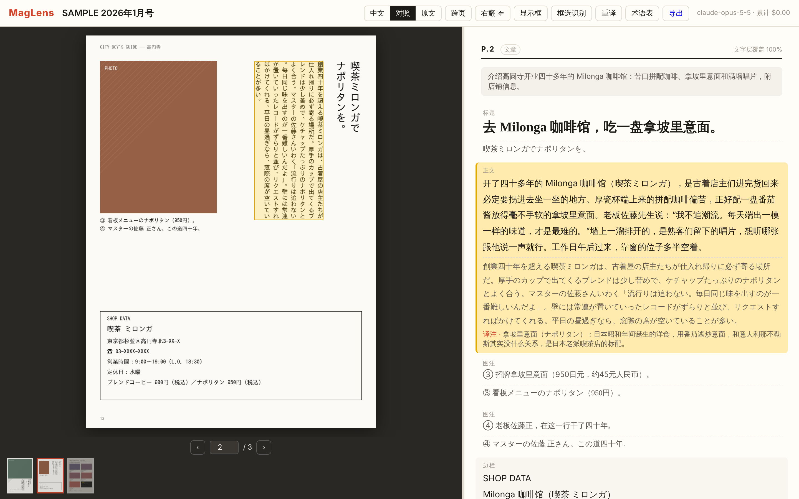

# MagLens — 本地日文杂志阅读 + 翻译

左边看杂志页面，右边看中文译文。用 Claude 视觉模型识别整页图片，再拿 PDF 文字层交叉核对、补上漏掉的部分，翻译成大陆生活方式杂志的中文风格。



## 在 Mac 上运行（Python ≥ 3.11）
```bash
git clone https://github.com/Siirui/maglens.git && cd maglens
python3 -m venv .venv && source .venv/bin/activate
pip install -r requirements.txt
```
杂志目录在 `config.toml` 的 `[library] dir` 里设置（默认 `~/Magazines/2026`），也可以用 `--dir` 临时指定。
目录里如果有整本扫描成 JPG 的文件夹，会自动转成 PDF，放在 `~/.maglens/converted/`，原文件夹不会改动。

翻译有两种方式，结果都保存在 `~/.maglens`，不会重复花钱：

**A. 边看边翻（需要 Console API key）**
```bash
export ANTHROPIC_API_KEY=sk-ant-api...
python run.py
```
浏览器会自动打开 http://127.0.0.1:8765 。打开哪一页就翻译哪一页，同时预取后面 2 页。

**B. 整本批量翻（不需要 API key，走 Claude 订阅）**
```bash
python -m maglens.cli_runner --series popeye --model haiku     # 从最新一期往前，一本一本翻
python run.py --manual                                          # 另开一个终端：只读模式看结果
```
它通过 Claude Code 的 `claude -p` 逐页调用，算在你的订阅用量里，额度用完后从 usage credits 扣。
用 Haiku 时每页约 $0.01（按标价折算），一本约 1 小时。顶部有进度条，跑完的页面会自动出现。
中途中断（合盖、断网）也没关系，重跑同一条命令会跳过已经完成的页。

没设 key 且没加 `--manual` 时会进入模拟模式，只显示 PDF 文字层，用来检查界面是否正常。

## 常用设置（config.toml / 命令行）
- `--model claude-sonnet-5-5` 或 `claude-haiku-5-5`：更便宜；默认 `claude-opus-5-5` 效果最好
- `--effort low|medium|high`：识别的细致程度
- `show_cny`：价格后面附上约合人民币

## 快捷键
←/→ 翻页（默认右翻，跟日本杂志一样）· S 跨页 · 1/2/3/4 整页/适应宽度/适应高度/铺满 · +/−/0 缩放（也可以用 ⌘+滚轮或双指捏合）· B 显示文本框 · R 框选识别 · Esc 取消框选

## 账号与部署（自用 / 朋友圈）
```bash
python -m maglens.users add 你的名字 --role admin   # 有账号后就需要登录；没有账号时本机所有人都是管理员
python -m maglens.users add 朋友A                    # 读者：只能看已经翻完的杂志，看不到管理按钮和花费
python -m maglens.publish --out dist                 # 导出预渲染页面 + 精简数据库（不含 PDF）
```
部署到云服务器的完整步骤（香港轻量服务器 + Caddy HTTPS + `deploy/sync.sh` 同步）见 [docs/DEPLOY.md](docs/DEPLOY.md)。
只适合私下使用：不开放注册、禁止搜索引擎收录。杂志和译文的版权属于出版方，请勿公开传播或收费。

## 开发
```bash
pip install -r requirements-dev.txt
python -m pytest tests            # 用回放的模型响应和假的 claude 命令跑测试，不需要 key
python tests/make_sample.py x.pdf # 生成 3 页测试杂志
```
